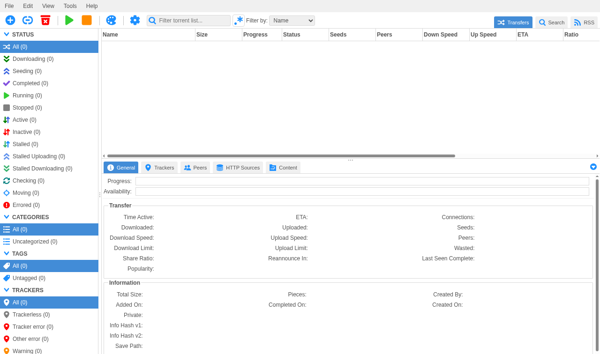

<!--
N.B.: This README was automatically generated by <https://github.com/YunoHost/apps_tools/blob/main/readme_generator>
It shall NOT be edited by hand.
-->

<h1>
  
  qBittorrent (static), packaged for YunoHost
</h1>

BitTorrent download client, static build with native I2P support

[](https://www.qbittorrent.org)
?style=for-the-badge)

## Screenshots


## 📦 Developer info


🛠️ Upstream qBittorrent (static) repository: <https://github.com/qbittorrent/qBittorrent>


The `testing` branch can be tested using:
```
# fresh install:
# upgrade an existing install:
```

You can also switch to the testing branch to update from testing by default (as same as for APT when you chose to use a testing repos) with this command:
```bash
sudo yunohost app setting qbittorrent_static upgrade_channel -v testing
```

### 📚 App packaging documentation

Please see <https://doc.yunohost.org/dev/packaging/> for more information.
